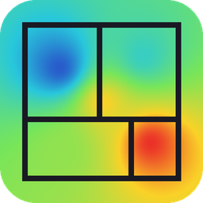

# Heatmap



Turn any floorplan into a live thermal heatmap using your existing Home Assistant temperature sensors. Install the integration, upload a floorplan image, pick your sensors, and drag the markers into place.

* IDW interpolation, jet/coolwarm/viridis/plasma/turbo/inferno colormaps
* Fixed vmin/vmax colour scaling
* Renders locally on the HA host with NumPy + Pillow
* Event-driven refresh plus configurable interval
* Ships a Lovelace card with an interactive marker editor


## Installation

You can install this custom component via HACS as a [custom repository](https://hacs.xyz/docs/faq/custom_repositories/) using `https://github.com/catcraft/HeatmappD` (category: Integration). Alternatively, clone or copy the `custom_components/heatmap` folder into the `custom_components` folder of your Home Assistant, then restart Home Assistant.

After the restart, add the integration under **Settings → Devices & Services → Add Integration → Heatmap**, upload your floorplan image and pick your temperature sensors.

## How to edit

### Layout

Open a dashboard, add the `Heatmap` card and press edit; the editor opens. Drag the markers onto the right spots on your floorplan.

After editing press **Save layout**, then save / exit. You might need to refresh the page, as updates aren't instant.


### Sensors & Config

Open **Entities / Devices**, edit your Heatmap and configure the settings there.

| General settings | Sensors |
| --- | --- |
|  |  |

## Configurability

Heatmap isn't limited to temperature. You can use **any sensor that reports a number**: temperature, CO2, humidity, noise, power, whatever you like. Pick the sensors, then set the colour range to match, e.g. 400-1500 for CO2 or 18-28 for temperature.

| Setting | What it does |
| --- | --- |
| Minimum / maximum | Values at the cold and hot end of the colour scale. Anything outside is clamped. |
| IDW power | How quickly a sensor's influence fades with distance. Higher means more local blobs, lower means smoother. |
| Overlay opacity | How strongly the heat colours cover the floorplan. |
| Colormap | `jet`, `coolwarm`, `turbo`, `viridis`, `plasma` or `inferno`. |
| Wall threshold (0-255) | Pixels darker than this count as walls. Heat is only drawn inside the rooms and walls stay crisp. |
| Compute grid downscale | Calculate on a smaller grid for speed (1 = full resolution). |
| Show sensor markers / marker radius | Toggle the dots and set their size. |
| Label font size | Size of the value text next to each marker. |
| Auto-invert label colour | Label text switches between black and white depending on the background, so it stays readable on dark colours. |
| Refresh interval | Seconds between refreshes (0 disables the timer). The image also updates when a sensor changes. |
| Highlight walls in red | Debug view to tune the wall threshold. |

## Dashboard card

```yaml
type: custom:heatmap-card
entity: image.living_room_heatmap
title: Ground floor
```
