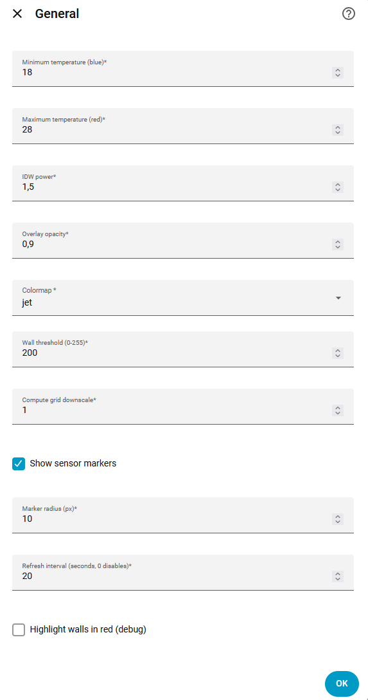
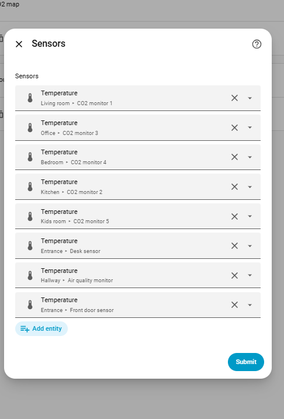

# HeatmappD


Turn any floorplan into a live thermal heatmap using your existing Home Assistant temperature sensors. Install the integration, upload a floorplan image, pick your sensors, and drag the markers into place.

* IDW interpolation, jet/coolwarm/viridis/plasma/turbo/inferno colormaps
* Fixed vmin/vmax colour scaling
* Renders locally on the HA host with NumPy + Pillow
* Event-driven refresh plus configurable interval
* Ships a Lovelace card with an interactive marker editor


## Installation

<!-- ha-marketplace:exclude-start -->
[](https://my.home-assistant.io/redirect/marketplace_repository/?owner=catcraft&repository=HeatmappD&category=integration)

On Home Assistant before 2026.11, use this button instead:

[](https://my.home-assistant.io/redirect/hacs_repository/?owner=catcraft&repository=HeatmappD&category=integration)

You can also install this custom component via HACS as a [custom repository](https://hacs.xyz/docs/faq/custom_repositories/) using `https://github.com/catcraft/HeatmappD` (category: Integration). Alternatively, clone or copy the `custom_components/heatmap` folder into the `custom_components` folder of your Home Assistant, then restart Home Assistant.
<!-- ha-marketplace:exclude-end -->

After the restart, add the integration under **Settings → Devices & Services → Add Integration → Heatmap**, upload your floorplan image and pick your temperature sensors.

## How to edit

### Layout

Open a dashboard, add the `Heatmap` card and press edit; the editor opens. Drag the markers onto the right spots on your floorplan.

Marker positions are applied when you press the dialog's **Save** button; **Cancel** discards them. **Discard changes** resets the markers while the editor is open.

To save positions immediately instead, enable **Auto-save layout** in the card editor (`auto_save: true`). Changes are then saved one second after you drop a marker.

The card config also gets a `layout_revision` value. The editor manages it to enable the Save button; leave it alone.


### Sensors & Config

Open **Entities / Devices**, edit your Heatmap and configure the settings there.

| General settings | Sensors |
| --- | --- |
|  |  |

## Configurability

Heatmap isn't limited to temperature. You can use **any sensor that reports a number**: temperature, CO2, humidity, noise, power, whatever you like. Pick the sensors, then set the colour range to match, e.g. 400-1500 for CO2 or 18-28 for temperature.

| Setting | What it does |
| --- | --- |
| Minimum / maximum | Values at the cold and hot end of the colour scale. Anything outside is clamped. New heatmaps start at 18-28 (°C) or 64-82 (°F), depending on your unit system. |
| IDW power | How quickly a sensor's influence fades with distance. Higher means more local blobs, lower means smoother. |
| Overlay opacity | How strongly the heat colours cover the floorplan. |
| Colormap | `jet`, `coolwarm`, `turbo`, `viridis`, `plasma` or `inferno`. |
| Wall threshold (0-255) | Pixels darker than this count as walls. Heat is only drawn inside the rooms and walls stay crisp. |
| Compute grid downscale | Calculate on a smaller grid for speed: 1 = full resolution, 2 = half. Fractions such as 1.2 are allowed; new heatmaps start at 1.2. Higher values look blockier but render faster. |
| Show sensor markers / marker radius | Toggle the dots and set their size. |
| Label font size | Size of the value text next to each marker. |
| Auto-invert label colour | Label text switches between black and white depending on the background, so it stays readable on dark colours. |
| Refresh interval | Seconds between refreshes (0 disables the timer). The image also updates when a sensor changes. |
| Highlight walls in red | Debug view to tune the wall threshold. |

## Dashboard card

```yaml
type: custom:heatmap-card
entity: image.living_room_heatmap
title: Ground floor
auto_save: false  # optional, save marker positions without pressing Save
```

The card's height follows the floorplan's aspect ratio. In a sections view you can still set a fixed number of rows; the floorplan is then fitted into them.

Floorplans can have up to 40 megapixels (for example 8000 × 5000).

### Recorder

The heatmap image entity's state is the time of the last render, so every new image is a state change in the recorder. A render that produces the same image is not recorded, but sensors that change often still add many rows. If you don't need the history, exclude the entity:

```yaml
recorder:
  exclude:
    entities:
      - image.living_room_heatmap
```

The card is loaded automatically on every dashboard (storage and YAML mode); you don't need to add a dashboard resource. Versions before 1.0.3 added one under **Settings → Dashboards → Resources**; it is removed automatically on the next start.

Casting a dashboard with Home Assistant Cast only loads dashboard resources. To show the card on a cast display, add `/heatmap/heatmap-card.js` as a JavaScript module resource by hand.
