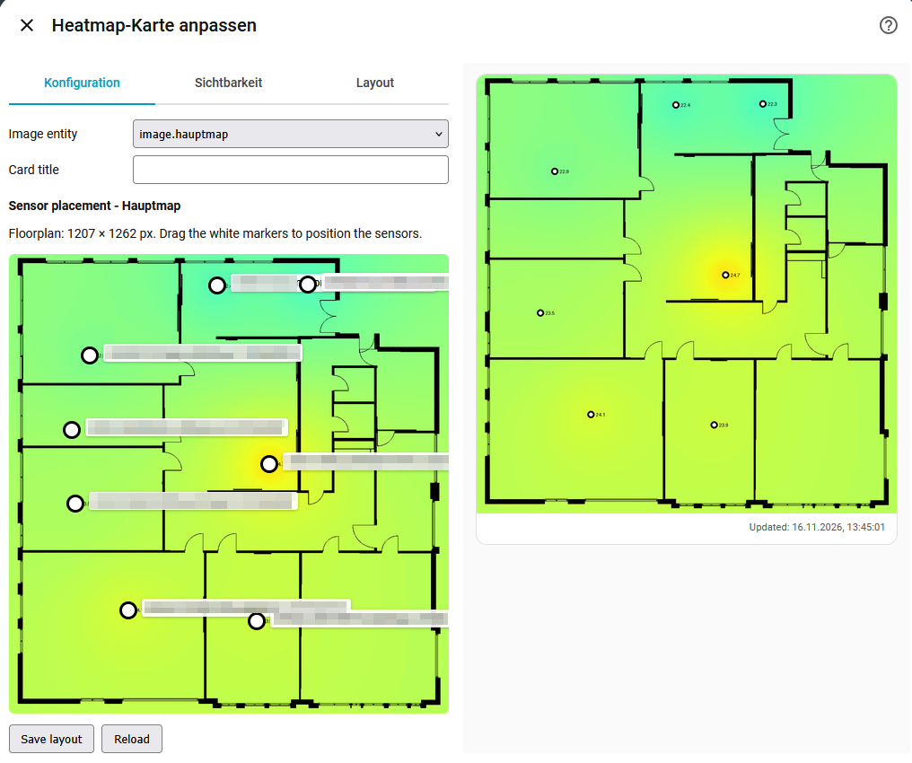

# Heatmap


Turn any floorplan into a live thermal heatmap using your existing Home Assistant temperature sensors. Install the integration, upload a floorplan image, pick your sensors, and drag the markers into place.

* IDW interpolation, jet/coolwarm/viridis/plasma/turbo/inferno colormaps
* Fixed vmin/vmax colour scaling
* Renders locally on the HA host with NumPy + Pillow
* Event-driven refresh plus configurable interval
* Ships a Lovelace card with an interactive marker editor


## Installation

You can install this custom component via HACS as a [custom repository](https://hacs.xyz/docs/faq/custom_repositories/) using `https://github.com/catcraft/HeatmappD` (category: Integration). Alternatively, clone or copy the `custom_components/heatmap` folder into the `custom_components` folder of your Home Assistant, then restart Home Assistant.

After the restart, add the integration under **Settings → Devices & Services → Add Integration → Heatmap**, upload your floorplan image and pick your temperature sensors.

## How to edit

### Layout

Open a dashboard, add the `Heatmap` card and press edit; the editor opens. Drag the markers onto the right spots on your floorplan.

After editing press **Save layout**, then save / exit. You might need to refresh the page, as updates aren't instant.



### Sensors & Config

Open **Entities / Devices**, edit your Heatmap and configure the settings there.

| General settings | Sensors |
| --- | --- |
|  |  |

## Dashboard card

```yaml
type: custom:heatmap-card
entity: image.living_room_heatmap
title: Ground floor
```
